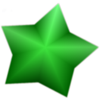
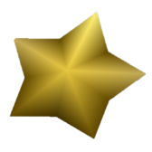
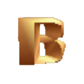
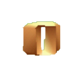
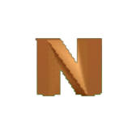
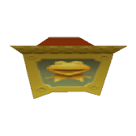
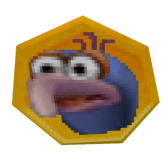

# Muppet Monster Adventure Locations

[Game Page] | [Setup] | [Items] | Locations

[Game Page]: en_Muppet%20Monster%20Adventure.md
[Setup]: setup_en.md
[Items]: items_en.md

## Locations
  * Each **Normal Level** has a number of Tokens (5 - 7), Evil Energy, and BONUS letters.
  * These total of Tokens, Evil Energy, and overall collected pickup percent is shown on the Level Select in the Hub World
  * The first 3 levels, *Peacock Purgatory*, *Hallways of Doom*, and *Poker Faces* have Monster Amulet Pieces
  * And each **Boss Level** completion is also a location
  * See [Items] for which level is a Normal level and which is a Boss level
  * All other items (Such as Coins (from defeating monsters twice), Lives, and Hearts) are not randomised

## Location Types
  The types of locations you're looking for are as follows:
  - *Tokens* - Each Token, including the one unlocked when collecting all BONUS letters, are checks  
    
  - *Evil Energy* - Collecting 50% and 100% are checks  
     
     
  - *BONUS Letters* - The 5 letters of the word BONUS, these are checks, and together, open a Bonus Token Chest  
     
     
     
  - *Monster Amulet Pieces* - Each of these are checks, and come in sets (showing the image of a Muppet on them) that together trigger a cutscene  
    
  - *Boss Level Completion* - No image, but beating a boss will give you a check
